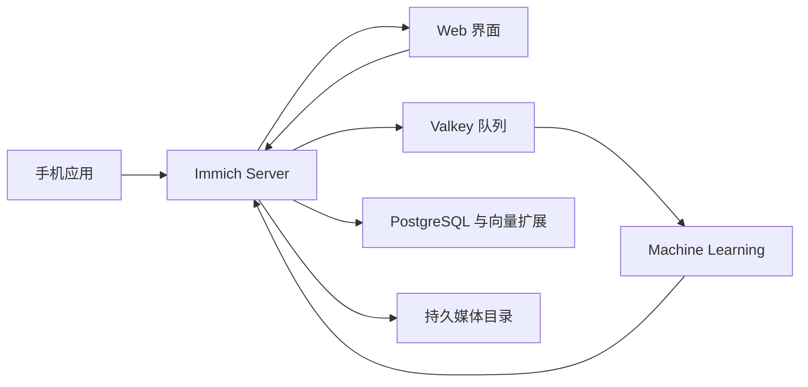

# Immich · Recipkg

**自托管照片与视频库：手机备份、时间线、搜索和分享。**

[](https://github.com/immich-app/immich)
[](https://github.com/immich-app/immich/blob/8303cb117e197c700332b33b61b45314c9cc5bb4/LICENSE)
[](https://github.com/recipkg/standard-library)

[标准库](https://github.com/recipkg/standard-library) · [配方](RECIPE.md) · [构建提示词](BUILD_PROMPT.md) · [验收计划](ACCEPTANCE.md) · [覆盖状态](COVERAGE.md) · [来源与许可](SOURCES.md)


这份仓库只保存 Markdown 重建配方，不是 Immich 源码或发行版。固定目标为上游 v3.3.5；配方仍在提取中。

## 软件组成



图示根据固定版本 Compose 和官方架构文档整理，表达组件关系，不表示本配方已重建或验收通过。数据库、队列、文件系统和模型均有独立版本、恢复与兼容要求。

## 固定来源

- 上游：[immich-app/immich v3.3.5](https://github.com/immich-app/immich/tree/8303cb117e197c700332b33b61b45314c9cc5bb4)
- 根许可证：AGPL-3.0；分发与使用前应另行核对依赖、模型和品牌素材
- 2026-10-29 星数快照：117,548；随时会变化，也不表示覆盖完整
- 标准库分类：文件与媒体 / 照片和视频管理

## Recipkg 依赖

| 别名 | 用途 | 状态 |
| --- | --- | --- |
| `quality` | 数据完整性、错误恢复与性能证据合同 | 指定 Recipkg 完整提交 |
| `design` | 媒体浏览、跨端界面和状态反馈的设计方向 | 递归包含设计基础 |
| `valkey` | 官方 Compose 使用的队列服务 | 配方尚未验证 BullMQ 集成 |

PostgreSQL 与扩展镜像是运行要求，但标准库尚无覆盖这套数据库组合的配方。以上设计和质量合同不是运行时库。详情见 [SOURCES.md](SOURCES.md)。

## 检查配方包

```sh
out_dir="$(mktemp -d)"
recipkg pack . -o "$out_dir/immich-0.1.0.recipe.tar.gz"
recipkg check "$out_dir/immich-0.1.0.recipe.tar.gz"
recipkg build "$out_dir/immich-0.1.0.recipe.tar.gz" --lang zh-CN --output "$out_dir/build.md"
```

打包和归档检查只验证 Recipkg 材料及递归依赖。它们不能代替 [ACCEPTANCE.md](ACCEPTANCE.md) 中尚未执行的软件验收。
